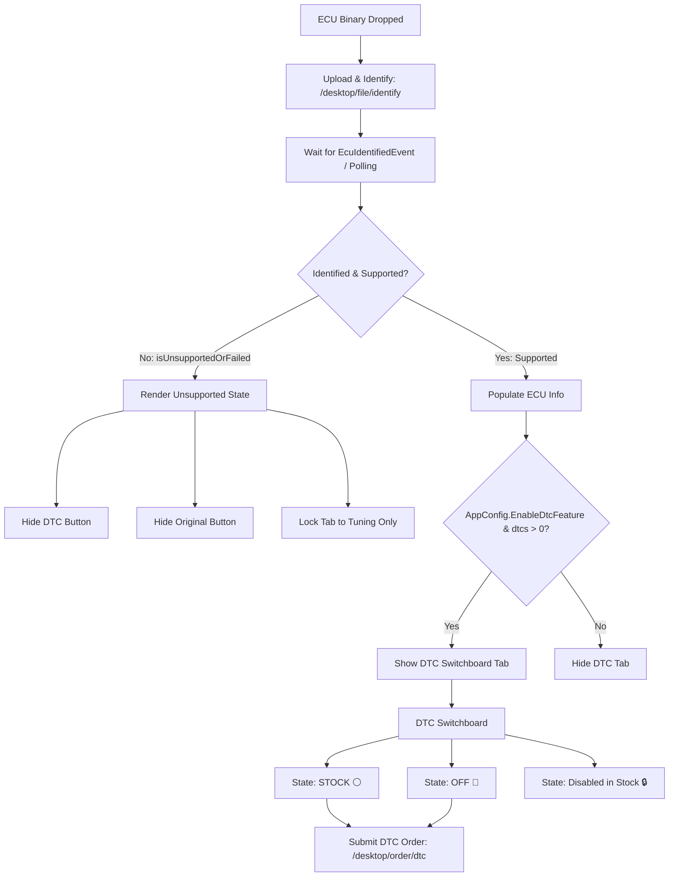

# ADI Performance — Desktop Client Application


A cross-platform desktop client application for the **ADI Performance** ECU tuning and file management ecosystem, built with **C# (.NET 9)** and **Avalonia UI**.

---

## 📌 Role & Purpose

The **ADI Desktop Application** serves as the primary workbench for professional automotive workshops, tuners, and mechanics. It bridges local ECU hardware and binary file reading tools directly with ADI's high-performance cloud tuning services and expert engineering support.

### Key Capabilities:
1. **ECU Binary Ingestion & Auto-Identification**:
   - Drag-and-drop vehicle ECU binaries (`.bin`, `.ori`, `.hex`).
   - Automated file hashing, size validation, and engine/ECU identification.
   - **Isolation & Gating for Unsupported Files**: Strict UI isolation when an ECU is unidentified or unsupported (`isUnsupportedOrFailed`), hiding DTC and original file tabs and defaulting workflows to standard tuning requests.
2. **On-Demand Chiptuning Services**:
   - Request Stage 1 / Stage 2 power calibrations, DPF / EGR / AdBlue removals, Pop & Bang crackle maps, launch control, and speed limiter adjustments.
3. **Map-Driven DTC Switchboard & Restoration**:
   - Interactive diagnostic fault code switchboard with instant search and category filtering.
   - **Two-State Action Toggle**: Switches seamlessly between `⚪ STOCK` and `🔴 OFF`.
   - **Factory Deactivation Safeguard (`🔒 Disabled in Stock`)**: Automatically detects codes already turned off in OEM calibration and locks them to prevent invalid toggling.
   - **Dynamic DTC Ordering**: Computes actions (`{ off: [...], on: [...] }`) and updates order button count dynamically.
4. **Token & Subscription Accounting**:
   - Real-time token credit management displaying **Available Balance**, **Reserved Tokens** (held during pending order processing), and **Effective Balance**.
   - Desktop license validation and subscription expiration monitoring.
4. **Real-Time Reactive Order Tracking**:
   - WebSocket-powered live notifications (`OrderStatusUpdatedEvent`) for order status updates (Pending $\rightarrow$ Processing $\rightarrow$ Finished/Cancelled) without periodic polling.
   - Direct one-click download of modified binary files (`.mod`) upon completion.
5. **Support Tickets & Communication**:
   - Built-in engineering support ticketing and direct communication with ADI file calibrators.
6. **Hardware & Environment Security**:
   - Virtual machine detection (`VmDetector`) and hardware ID binding for license protection.
7. **Full Multi-Language Support**:
   - Dynamic live language switching across English, French, Spanish, and German.

---

## 🏗️ Architecture & Technology Stack

* **Runtime & Language**: .NET 9.0 / C# 13
* **UI Framework**: [Avalonia UI](https://avaloniaui.net/) (Cross-platform XAML styling and controls)
* **API Integration**: RESTful communication with Sanctum Bearer token authentication via `ApiService`
* **Real-time Engine**: WebSocket Client (`PusherClient`) for bidirectional live events
* **Cross-Platform Target**: macOS (Apple Silicon & Intel), Windows 10/11 (x64), Linux (x64/ARM64)

---

## 🔧 ECU Identification & DTC Workflow (`TuneView.axaml.cs`)



### Key Workflow Rules:
1. **Unidentified / Unsupported ECU Isolation**:
   - When an ECU binary has no matching database or similarity profile (`isUnsupportedOrFailed == true`), the DTC tab and Original File tab are hidden.
   - Any attempt to navigate to the DTC or Original tab automatically redirects to the Tuning workflow.
2. **Interactive Fault Code Management**:
   - Real-time search and filter by DTC prefix or code string.
   - Dynamic button counter displays total modifications ready for order submission (e.g. `Order DTC Off (2)`).
   - Prevents toggling codes that are already deactivated in the factory stock file.

---

## 📂 Project Structure

```
ADIapp/
├── Assets/                 # High-resolution logos, application icons, and UI backgrounds
├── Config/
│   └── AppConfig.cs        # Backend API URLs, WebSocket endpoints, and version configuration
├── Helpers/
│   ├── HardwareHelper.cs   # Hardware fingerprinting and platform detection
│   ├── Logger.cs           # Centralized application file and console logging
│   ├── NetworkHelper.cs    # Connectivity detection and offline fallback
│   ├── UpdateInstallerHelper.cs # Silent background installer launcher
│   └── VmDetector.cs       # Anti-tamper virtual machine environment detection
├── Models/
│   ├── RequestPayloads.cs  # DTO payloads for authentication, orders, and tickets
│   └── ResponseDtos.cs     # Serialized API responses (Users, Orders, Tickets, Services)
├── Services/
│   ├── ApiService.cs       # Core HTTP communication, authentication, and caching
│   ├── LanguageService.cs  # Centralized multi-language dictionary (EN, FR, ES, DE)
│   ├── UpdateService.cs    # Automatic background version and release updater
│   └── WebSocketManager.cs # Pusher/Reverb WebSocket connection and event dispatching
├── Views/                  # Avalonia XAML user interfaces and code-behind
│   ├── AppShellView.axaml  # Main persistent app shell with responsive sidebar & top panel
│   ├── HomeView.axaml      # Main dashboard with fast actions and recent activity
│   ├── TuneView.axaml      # ECU binary upload, identification, and tuning order builder
│   ├── OrderHistoryView.axaml # Full searchable and filterable order history
│   ├── TokenView.axaml     # Token accounting and available vs. reserved credit view
│   ├── TicketView.axaml    # Support tickets management and live replies
│   ├── SettingsView.axaml  # App preferences and language switcher
│   ├── AccountView.axaml   # User profile management and phone validation
│   └── LoginView.axaml     # Authentication and credential persistence
├── installer/              # Packaging and release build scripts
│   ├── macos/              # macOS DMG builder and Info.plist
│   ├── windows/            # Windows Inno Setup installer script and batch builder
│   └── linux/              # Debian package (.deb) builder
└── Program.cs              # Application bootstrapper and Avalonia configuration
```

---

## 🚀 Getting Started

### Prerequisites
* [.NET 9.0 SDK](https://dotnet.microsoft.com/download/dotnet/9.0) installed on your system.

### Running Locally (Development)
```bash
cd ADIapp
dotnet run
```

---

## 📦 Building Installers

### 🍎 macOS (`.dmg`)
Run the macOS packaging script (supports `osx-x64` for Intel or `osx-arm64` for Apple Silicon):
```bash
# Build for Intel Mac
./installer/macos/build-dmg.sh osx-x64

# Build for Apple Silicon (M1/M2/M3/M4)
./installer/macos/build-dmg.sh osx-arm64
```
*Output*: Generated `.dmg` installer files in `dist/`.

---

### 🪟 Windows (`.exe` Setup / `.zip`)
1. **Self-Contained Portable ZIP**:
   ```bash
   ./installer/windows/package-windows-zip.sh
   ```
2. **Inno Setup Single-File `.exe` Installer** (on a Windows PC):
   ```cmd
   cd installer\windows
   build-windows-setup.bat
   ```
*Output*: Generated `dist/ADIapp-Windows-Setup-x64.exe`.

---

### 🐧 Linux (`.deb` / `.tar.gz`)
```bash
./installer/linux/build-deb.sh linux-x64
```
*Output*: Debian package `.deb` in `dist/`.

---

## 🔒 Security & Verification

* All sensitive binary transmissions use encrypted TLS 1.3 endpoints.
* Hardware profiling binds active subscription instances to validated physical workstations.
* Real-time WebSocket channels use authenticated private user channels (`private-user.{id}`).

---

## 📄 License
Copyright © 2026 ADI Performance. All rights reserved.
